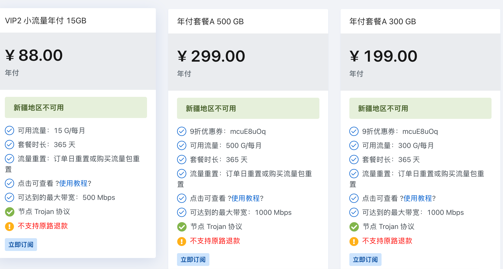

# 大哥云：套餐截图与维护者长期体验

资料接收及人工核对日期：2026-10-13。来源为维护者在对话中提供的两张套餐页截图，服务入口由同一维护者先前提供为 https://a03.dgy02.com/。图片自身未显示域名，服务归属依据对话上下文；并非程序登录后台取得的数据。截图拍摄日期未显示，套餐当前结算以后台为准。

## 可归档的年付截图

## 套餐逐项转录

第二张截图以内嵌图片提供，当前没有独立本地附件文件，以下保留人工核对的事实记录。

| 套餐 | 标价 | 付款周期与有效期 | 每月流量 | 页面宣称带宽 |
| --- | --- | --- | --- | --- |
| VIP2 小流量年付15GB | 88元 | 年付 / 365天 | 15GB | 500Mbps |
| 年付套餐A 500GB | 299元 | 年付 / 365天 | 500GB | 1000Mbps |
| 年付套餐A 300GB | 199元 | 年付 / 365天 | 300GB | 1000Mbps |
| 季付套餐A 200GB | 69元 | 标题“季付”、价格下方“半年付”、时长90天，存在冲突 | 200GB | 1000Mbps |
| 单月套餐B 150GB | 29元 | 月付 / 按自然月计算 | 150GB | 500Mbps |
| 单月套餐A 100GB | 19.90元 | 月付 / 按自然月计算 | 100GB | 500Mbps |

6个套餐均标注Trojan协议、新疆地区不可用、不支持原路退款。年付与69元套餐列订单日重置或购买流量包重置；单月套餐列订单日重置或续费套餐重置。

300GB与500GB年付套餐列9折优惠券 `mcuE8uOq`，未显示有效期、次数或完整适用条件，因此只记录，不应用到价格排行。手续费、设备限制、节点倍率未在截图中明确，保持待核验；倍率暂按全库默认1计算。

69元套餐的周期不能擅自认定为3个月或6个月，故保留付款周期冲突说明并排除概览的入门套餐选择和全部价格排行。

## 维护者长期体验报告

维护者于2026-10-13说明：大哥云是主要使用的机场，稳定使用2年以上，未遇到问题；节点足够丰富，稳定性强，性价比高。

这是维护者本人长期使用反馈，用于“维护者主力”推荐标签及推荐优先展示。反馈未提供地区、运营商、分项测速记录，因此不生成quality测试分，不把个人体验写成所有用户的性能保证。价格榜继续按流量单价排序，不因为主力推荐改变数学排名。
